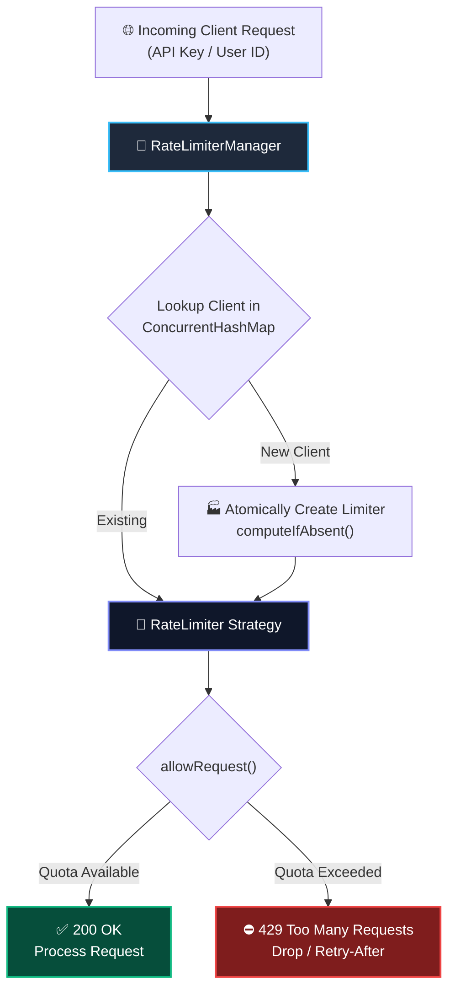
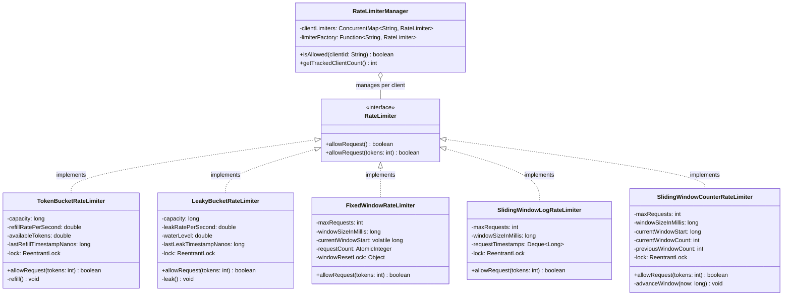
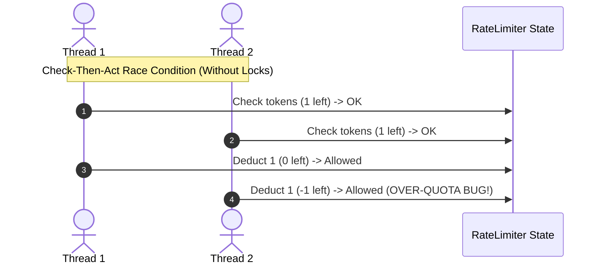

# 🛡️ High-Performance Thread-Safe Rate Limiter (Java LLD)


A production-grade, zero-dependency **Low-Level Design (LLD)** of a distributed-ready **Rate Limiter** in Java. Implements all 5 industry-standard rate-limiting algorithms with **strict thread safety**, lock-free optimizations, and a multi-tenant client manager.

---

## 📑 Table of Contents
- [System Architecture](#-system-architecture)
- [Class Design (UML)](#-class-design-uml)
- [How Each Algorithm Works](#-how-each-algorithm-works)
  - [1. Token Bucket](#1-token-bucket-algorithm)
  - [2. Leaky Bucket](#2-leaky-bucket-traffic-shaper)
  - [3. Fixed Window Counter](#3-fixed-window-counter)
  - [4. Sliding Window Log](#4-sliding-window-log)
  - [5. Sliding Window Counter](#5-sliding-window-counter-hybrid)
- [Algorithm Comparison Matrix](#-algorithm-comparison-matrix)
- [Thread-Safety & Concurrency Engineering](#-thread-safety--concurrency-engineering)
- [Quick Start & Code Examples](#-quick-start--code-examples)
- [Concurrency Stress Test Results](#-concurrency-stress-test-results)

---

## 🏗️ System Architecture

The rate limiter sits between incoming client requests and downstream services. It supports multi-tenancy (per API key, User ID, or IP) using an atomic `ConcurrentHashMap` registry.



---

## 📐 Class Design (UML)

Built using the **Strategy Pattern** for interchangeable rate-limiting algorithms and the **Flyweight/Factory Pattern** for multi-tenant tenancy.



---

## 🔍 How Each Algorithm Works

### 1. Token Bucket Algorithm
- **Mechanism:** Tokens are continuously refilled into a bucket of fixed `capacity` at a constant `refillRatePerSecond`. Each request takes $N$ tokens.
- **Bursts:** Allowed up to full `capacity`.
- **Optimization:** Tokens are refilled **lazily** during `allowRequest()` using elapsed nanoseconds, eliminating background polling threads.

```text
[Incoming Request] ---> Needs 1 Token ---> [ 🪙 🪙 🪙  Bucket (Cap: 5) ] ---> ✅ Allowed
                                              ^
                         Refill: +2 tokens/sec |
```

---

### 2. Leaky Bucket (Traffic Shaper)
- **Mechanism:** Requests enter a bucket (queue) and leak out at a constant, uniform rate. If incoming volume exceeds bucket depth, excess requests are immediately rejected.
- **Bursts:** Smoothed out into a steady, flat stream. Ideal for protecting fragile databases.

```text
[Burst of 10 requests] ---> 🪣 Bucket (Cap: 4) ---> Excess 6 Dropped (429)
                                  │
                                  ▼ (Constant leak: 2 req/sec)
                             [Smooth Flow to DB]
```

---

### 3. Fixed Window Counter
- **Mechanism:** Divides timeline into rigid time blocks (e.g., $[00:00 - 00:01]$). Increments counter per request; resets to 0 on window rollover.
- **Trade-off:** Prone to **boundary spike** where double the quota can pass across the edge of two windows.
- **Optimization:** Implemented using lock-free **Atomic CAS** (`AtomicInteger.compareAndSet`).

---

### 4. Sliding Window Log
- **Mechanism:** Keeps an exact timestamp queue (`Deque<Long>`) of every permitted request. On each request, pops timestamps older than $(now - windowSize)$.
- **Accuracy:** $100\%$ boundary precision.
- **Trade-off:** High memory usage ($O(N)$ space where $N$ is total requests in window).

---

### 5. Sliding Window Counter (Hybrid)
- **Mechanism:** Blends counts from the previous window and current window based on the sliding overlap percentage:
  $$\text{Estimated Count} = \left(\text{Previous Count} \times \frac{\text{Window Size} - \text{Elapsed in Current}}{\text{Window Size}}\right) + \text{Current Count}$$
- **Industry Usage:** Used by Cloudflare and Kong API Gateways for $O(1)$ memory with near-perfect burst protection.

---

## 📊 Algorithm Comparison Matrix

| Algorithm | Time Complexity | Space Complexity | Burst Handling | Edge-Spike Protected? | Best Production Use Case |
| :--- | :---: | :---: | :---: | :---: | :--- |
| **Token Bucket** | $\mathcal{O}(1)$ | $\mathcal{O}(1)$ | ✅ Yes (to capacity) | ✅ Yes | Public APIs (AWS, Stripe, GitHub) |
| **Leaky Bucket** | $\mathcal{O}(1)$ | $\mathcal{O}(1)$ | ❌ No (smoothes) | ✅ Yes | Ingestion pipelines, slow database protection |
| **Fixed Window** | $\mathcal{O}(1)$ | $\mathcal{O}(1)$ | ❌ No | ❌ No ($2\times$ burst) | Internal metrics, simple throttling |
| **Sliding Log** | $\mathcal{O}(N)$ | $\mathcal{O}(N)$ | ⚠️ Partial | ✅ Yes (100% exact) | Payment gateways, high-security authorization |
| **Sliding Counter** | $\mathcal{O}(1)$ | $\mathcal{O}(1)$ | ⚠️ Moderate | ✅ Yes (smoothed) | High-throughput edge reverse proxies |

---

## 🔒 Thread-Safety & Concurrency Engineering

In concurrent systems, standard `if (count < limit) count++` suffers from **Check-Then-Act Race Conditions**, allowing quota breaches.



### How Our Code Guarantees Thread-Safety:

1. **Explicit Synchronization (`ReentrantLock`)**:
   - `TokenBucket`, `LeakyBucket`, and `SlidingWindow` algorithms encapsulate state calculation and mutation inside `lock.lock()` / `try ... finally { lock.unlock(); }`.
2. **Lock-Free CAS Loop (`AtomicInteger`)**:
   - `FixedWindowRateLimiter` uses hardware-level CPU compare-and-swap instructions:
     ```java
     while (true) {
         int current = requestCount.get();
         if (current + tokens > maxRequests) return false;
         if (requestCount.compareAndSet(current, current + tokens)) return true;
     }
     ```
3. **Double-Checked Locking**:
   - Window rollover in `FixedWindowRateLimiter` uses a volatile timestamp with double-checked synchronization to prevent multi-thread reset races.
4. **Multi-Tenant Atomic Instantiation**:
   - `RateLimiterManager` utilizes `ConcurrentHashMap.computeIfAbsent()`, ensuring only one limiter instance is created per client even under simultaneous initial traffic.

---

## 🚀 Quick Start & Code Examples

### 1. Using Individual Rate Limiters

```java
// Create a Token Bucket: Capacity = 10, Refill = 5 tokens per second
RateLimiter limiter = new TokenBucketRateLimiter(10, 5.0);

if (limiter.allowRequest()) {
    // Process request
} else {
    // Return HTTP 429 Too Many Requests
}
```

### 2. Multi-Tenant Per-Client Rate Limiting

```java
// Manager configured with Token Bucket strategy per user
RateLimiterManager manager = new RateLimiterManager(100, 10.0);

// Thread-safe check per client IP / API Key
boolean allowed = manager.isAllowed("user_api_key_abc123");
```

---

## 🧪 Concurrency Stress Test Results

Executed using a 50-thread concurrent pool with `CountDownLatch` synchronization to trigger 500 requests at the **exact same millisecond**:

```text
===============================================================
       RATE LIMITER LOW LEVEL DESIGN - COMPREHENSIVE DEMO      
===============================================================

>>> 1. Testing Token Bucket Rate Limiter (Capacity: 3, Refill: 2 tokens/sec)
Request 1: ALLOWED
Request 2: ALLOWED
Request 3: ALLOWED
Request 4 (Burst exceeded): REJECTED
Sleeping 600ms for partial refill...
Request 5 (After refill): ALLOWED
Request 6 (Immediate next): REJECTED

>>> 2. Testing Leaky Bucket Rate Limiter (Capacity: 2, Leak: 2 requests/sec)
Request 1: ALLOWED
Request 2: ALLOWED
Request 3 (Overflow): REJECTED
Sleeping 600ms for leak...
Request 4 (After leak): ALLOWED

>>> 3. Testing Fixed Window Rate Limiter (Max: 2 requests / 500ms window)
Req 1: ALLOWED
Req 2: ALLOWED
Req 3 (Limit reached): REJECTED
Sleeping 550ms for window rollover...
Req 4 (New window): ALLOWED

>>> 4. Testing Sliding Window Log Rate Limiter (Max: 2 requests / 500ms)
Req 1: ALLOWED
Req 2: ALLOWED
Req 3 (Exceeded): REJECTED
Sleeping 550ms for log expiry...
Req 4 (After expiration): ALLOWED

>>> 5. Testing Sliding Window Counter Rate Limiter (Max: 3 requests / 500ms)
Req 1: ALLOWED
Req 2: ALLOWED
Req 3: ALLOWED
Req 4 (Exceeded): REJECTED

>>> 6. Testing Concurrency & Thread-Safety Stress Test
Total Concurrent Requests: 500
Target Allowed Capacity:   50
Actual Allowed Requests:   50
Actual Rejected Requests:  450
 Thread-safety check SUCCESS: Exact capacity permitted without race conditions!

>>> 7. Testing Multi-Tenant RateLimiterManager (Per-Client Limits)
Client A - Req 1: ALLOWED
Client A - Req 2: ALLOWED
Client A - Req 3: REJECTED
Client B - Req 1: ALLOWED
Client B - Req 2: ALLOWED
Client B - Req 3: REJECTED
Tracked Active Clients in Manager: 2

All Rate Limiter tests and concurrency verifications PASSED successfully!
```

---

## 🛠️ Build & Run Locally

```bash
# Clone the repository
git clone https://github.com/iam-ssrivastav/rate-limiter-lld.git
cd rate-limiter-lld

# Compile all classes
javac -d bin $(find src -name "*.java")

# Run the complete demo & concurrency verification
java -cp bin ratelimiter.Main
```

---

## 📄 License
This project is open-source and available under the [MIT License](LICENSE).
