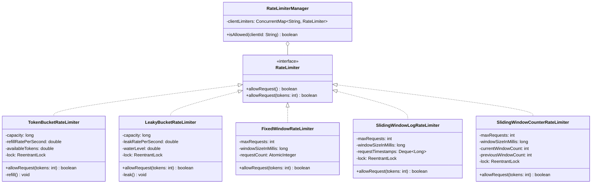

# Thread-Safe Rate Limiter (Low-Level Design in Java)

A complete, production-grade Low-Level Design (LLD) of a **Rate Limiter** implemented in Java. Covers all 5 major rate-limiting algorithms with **strict thread safety**, zero race conditions under high concurrency, comprehensive Javadocs, and a multi-tenant client manager.

---

## Algorithms Implemented

1. **Token Bucket** (`TokenBucketRateLimiter`)
   - Continuous replenishment based on elapsed time ($O(1)$ memory, supports burst traffic).
   - Guarded by `ReentrantLock` for atomic lazy-refill and permit deduction.

2. **Leaky Bucket** (`LeakyBucketRateLimiter`)
   - Fixed capacity queue that drains at a constant rate ($O(1)$ memory, traffic shaping).
   - Smooths out bursts to protect downstream services.

3. **Fixed Window Counter** (`FixedWindowRateLimiter`)
   - Fixed time slices using non-blocking atomic CAS operations (`AtomicInteger.compareAndSet`).
   - Double-checked locking only on window rollover.

4. **Sliding Window Log** (`SlidingWindowLogRateLimiter`)
   - Precise tracking of request timestamps in a synchronized `Deque<Long>`.
   - 100% boundary accuracy with stale timestamp eviction.

5. **Sliding Window Counter** (`SlidingWindowCounterRateLimiter`)
   - Hybrid approximator combining Fixed Window efficiency ($O(1)$ space) with Sliding Log boundary accuracy.
   - Calculates a weighted estimate based on the current window elapsed ratio.

6. **Multi-Tenant Rate Limiter Manager** (`RateLimiterManager`)
   - Thread-safe per-client rate limiter using `ConcurrentHashMap.computeIfAbsent`.

---

## Comparison Matrix

| Algorithm | Time Complexity | Space Complexity | Handles Bursts? | Boundary Spike Issue? | Best Use Case |
| :--- | :--- | :--- | :--- | :--- | :--- |
| **Token Bucket** | $O(1)$ | $O(1)$ | Yes (up to capacity) | No | Web APIs, AWS/Stripe-like public rate limiting |
| **Leaky Bucket** | $O(1)$ | $O(1)$ | No (enforces smooth output) | No | Downstream protection & traffic shaping |
| **Fixed Window** | $O(1)$ | $O(1)$ | No | Yes (up to $2\times$ at edges) | Simple counting, low criticality |
| **Sliding Window Log** | $O(N)$ | $O(N)$ | Partial | No (100% accurate) | Security-critical low-volume operations |
| **Sliding Window Counter** | $O(1)$ | $O(1)$ | Moderate | No (smoothed estimate) | High-throughput distributed API gateways |

---

## Architecture & Class Diagram



---

## Project Structure

```text
rate_limiter_lld/
├── src/
│   └── ratelimiter/
│       ├── RateLimiter.java                         # Core contract
│       ├── Main.java                                # Concurrency tests & execution demo
│       ├── impl/
│       │   ├── TokenBucketRateLimiter.java
│       │   ├── LeakyBucketRateLimiter.java
│       │   ├── FixedWindowRateLimiter.java
│       │   ├── SlidingWindowLogRateLimiter.java
│       │   └── SlidingWindowCounterRateLimiter.java
│       └── manager/
│           └── RateLimiterManager.java              # Per-client management
├── .gitignore
└── README.md
```

---

## How to Build and Run

### Prerequisites
- Java 17+ (JDK 17 or higher)

### Compile
```bash
javac -d bin $(find src -name "*.java")
```

### Run Demo & Concurrency Tests
```bash
java -cp bin ratelimiter.Main
```

### Concurrency Stress Test Results
```text
>>> Testing Concurrency & Thread-Safety Stress Test
Total Concurrent Requests: 500
Target Allowed Capacity:   50
Actual Allowed Requests:   50
Actual Rejected Requests:  450
 Thread-safety check SUCCESS: Exact capacity permitted without race conditions!
```
